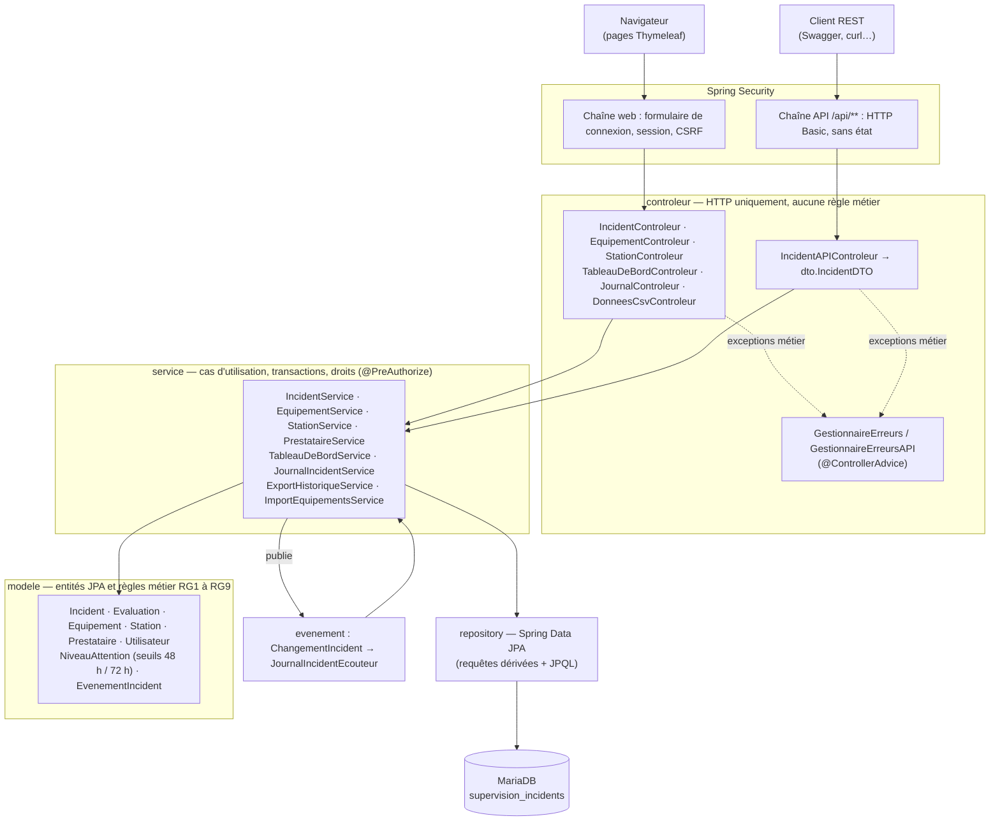

# Journal — Panne-O-Rama (ALTN72, 2026-27)

**Groupe :** Ivan LAI, Clayton HABYALIMANA (GitHub : Clayton2394)

Panne-O-Rama est une application web de supervision des incidents survenant sur les équipements des
stations (ascenseurs, escalators, portiques, distributeurs, écrans d'information). Un agent signale les
pannes, le responsable d'exploitation les suit, les fait prendre en charge par un prestataire, les clôture
et évalue l'intervention.

---

## README

### Prérequis

| Outil | Version | Remarque |
|---|---|---|
| Java (JDK) | 21 | `JAVA_HOME` doit pointer sur un JDK 21 (un JDK 17 échoue avec « release version 21 not supported ») |
| Maven | fourni | le wrapper `mvnw` / `mvnw.cmd` est inclus, aucune installation nécessaire |
| MariaDB | 10.4 ou plus | par exemple via XAMPP, sur `localhost:3306` |
| Navigateur | récent | les polices (Fredoka, Nunito) sont chargées depuis Google Fonts ; hors ligne, une police système prend le relais |

### Configuration

La connexion à la base est lue dans `src/main/resources/application.properties`, avec des valeurs par
défaut adaptées à XAMPP. Elle peut être surchargée par des variables d'environnement, sans modifier le code
ni committer de mot de passe :

| Variable | Valeur par défaut |
|---|---|
| `DB_URL` | `jdbc:mariadb://localhost:3306/supervision_incidents` |
| `DB_USERNAME` | `root` |
| `DB_PASSWORD` | *(vide)* |

### Initialiser la base

Le script `db/create.sql` supprime puis recrée la base `supervision_incidents`, ses tables et les données
de démonstration, en quelques secondes :

```bash
mysql -u root < db/create.sql
# Windows / XAMPP :
C:\xampp\mysql\bin\mysql -u root < db\create.sql
```

Les dates d'ouverture des incidents de démonstration sont calculées **relativement à l'instant présent**
(`DATE_SUB(NOW(), INTERVAL 47 HOUR)`…) : les cas limites du tableau de bord restent valables quel que soit
le jour où le script est lancé.

| Incident | Ouvert il y a | Statut | Ce qu'il permet de vérifier |
|---|---|---|---|
| Porte bloquée | 47 h | non affecté | indicateur **vert** (juste sous 48 h) |
| Marches à l'arrêt | 48 h pile | non affecté | indicateur **orange** (48 h incluses) |
| Écran cassé | 73 h | non affecté | indicateur **rouge** (72 h et plus) |
| Moteur grillé | 20 h | affecté | « Pris en charge », jamais de couleur (RG4) |
| Vitre fêlée | 10 jours | résolu, évalué 4/5 | historique, évaluation, absence du tableau de bord (RG6) |


### Lancer l'application

```bash
./mvnw spring-boot:run          # Windows : mvnw.cmd spring-boot:run
```

Puis ouvrir <http://localhost:8080>. La documentation de l'API REST (Swagger UI) est disponible sur
<http://localhost:8080/swagger-ui.html> une fois connecté.

### Application déployée

`TODO : URL de l'application déployée (§7.9)`

### Comptes de test

| Profil | Identifiant | Mot de passe |
|---|---|---|
| Responsable d'exploitation | `resp1` | `responsable` |
| Agent de signalement | `agent1` | `agent` |

Les mots de passe ne sont stockés qu'**hachés avec BCrypt**, dans la base comme dans `db/create.sql` (§7.7).

### Limites connues

- Pas de gestion des stations, équipements, prestataires et utilisateurs depuis l'interface (création par
  script SQL, ou import CSV pour les équipements).
- L'import CSV ajoute des équipements ; il ne met pas à jour des équipements existants.
- Les listes (historique, journal) ne sont pas paginées ; le journal global se limite aux 200 derniers
  événements.
- La note d'un prestataire se consulte sur le détail de chaque incident ; il n'y a pas encore de fiche
  prestataire avec sa note moyenne.
- Le type d'un équipement est affiché sous la forme de son code (`ASCENSEUR`, `ECRAN_INFORMATION`…).

---

## ARCHITECTURE

- **Dépôt :** <https://github.com/Clayton2394/Panne-O-Rama>
- **Pile :** Spring Boot 4.1.1, Java 21, Spring MVC, Spring Data JPA (Hibernate), Spring Security,
  Bean Validation, Thymeleaf (+ `thymeleaf-extras-springsecurity6`), MariaDB, springdoc-openapi 3,
  Apache Commons CSV, JUnit 5, Mockito, AssertJ, H2 (tests de repository).

### Schéma



### Découpage en packages

| Package | Rôle |
|---|---|
| `controleur` | Reçoit les requêtes HTTP, valide les formulaires (`@Valid` + `BindingResult`), appelle **un** service et choisit la vue. Aucune règle métier. |
| `formulaire` | Objets de formulaire validés par Bean Validation (`DescriptionIncidentFormulaire`, `AffectationPrestataireFormulaire`, `EvaluationFormulaire`), pour ne jamais lier une entité JPA directement à une requête. |
| `service` | Cas d'utilisation : enchaîne les appels, porte les transactions et les contrôles de profil (`@PreAuthorize`). |
| `modele` | Entités JPA et **règles métier** : `Incident.resoudre()`, `affecterPrestataire()`, `verifierEvaluable()`, `niveauAttention()`, constructeur d'`Evaluation` (RG8)… |
| `repository` | Accès aux données (Spring Data JPA). |
| `dto` | Objets en lecture seule pour l'API (`IncidentDTO`), le tableau de bord et le rapport d'import. |
| `evenement` | Événements Spring du journal métier (lot alpha 5). |
| `exception` | Exceptions métier personnalisées, messages en français. |
| `configuration` | Sécurité, horloge (`Clock`), OpenAPI, auteur courant. |

Les contrôleurs ne dépendent que des services, les services du modèle et des repositories : chaque couche
peut être testée seule, en simulant (mock) la couche du dessous.

### Fonctionnalités du socle et où elles vivent

| N° | Fonctionnalité | Route(s) | Règles et emplacement |
|---|---|---|---|
| F1 | Connexion / déconnexion | `GET/POST /connexion`, `POST /deconnexion` | `SecurityConfig`, `UtilisateurDetailsService`, `UtilisateurConnecte` ; « Bonjour Prénom (profil) \| Déconnectez-vous » dans le bandeau commun |
| F2 | Équipements par station | `GET /stations`, `GET /stations/{id}/equipements` | `StationService`, `EquipementService` ; type et état affichés |
| F3 | Fiche d'un équipement | `GET /equipements/{id}` | incidents triés par date d'ouverture décroissante (RG7, requête dérivée) |
| F4 | Déclarer un incident | `GET /equipements/{id}/incidents/nouveau`, `POST /equipements/{id}/incidents` | RG1 dans le constructeur d'`Incident` (non affecté, sans prestataire, date du serveur) |
| F5 | Détail d'un incident | `GET /incidents/{id}` | durée d'ouverture calculée par `Incident.dureeOuverture(Clock)` ; prestataire et évaluation éventuels |
| F6 | Modifier un incident | `GET /incidents/{id}/modification`, `PATCH /incidents/{id}` | `Incident.modifierDescription()` refuse un incident résolu |
| F7 | Affecter / réaffecter | `GET /incidents/{id}/affectation`, `PATCH /incidents/{id}/prestataire` | `Incident.affecterPrestataire()` ; RG5 : refus si résolu |
| F8 | Déclarer résolu | `PATCH /incidents/{id}/resolution` (web) et `PATCH /api/incidents/{id}/resolution` (API) | `Incident.resoudre()` : RG5, date ≥ ouverture, pas de double résolution |
| F9 | Historique des résolus | `GET /incidents/historique` | JPQL `findHistoriqueResolus` trié par date de résolution décroissante (RG7) |
| F10 | Évaluer un prestataire | `GET/POST /incidents/{id}/evaluation` | RG8 dans `Incident.verifierEvaluable()` et le constructeur d'`Evaluation` ; unicité vérifiée par le service et par la contrainte `UNIQUE` |
| F11 | Tableau de bord | `GET /tableau-de-bord?stationId=&niveau=` | `NiveauAttention` (RG3, RG4), `TableauDeBordService` (RG6, tri, filtres, indicateurs) |
| F12 | API REST | `GET /api/incidents?statut=`, `GET /api/incidents/{id}`, `PATCH /api/incidents/{id}/resolution` | `IncidentAPIControleur`, erreurs au format `ProblemDetail` ; documentation Swagger |

---

## TESTS

### Stratégie

Les règles métier vivant dans le modèle et les services, l'essentiel des tests porte sur ces deux couches,
conformément à la pyramide des tests :

1. **Tests unitaires du modèle** (`IncidentTest`, `EvaluationTest`, `NiveauAttentionTest`) : pur Java, sans
   Spring ni base, donc très rapides. Ils vérifient les règles RG1 à RG8 et les transitions d'état.
2. **Tests unitaires des services** (`IncidentServiceTest`, `TableauDeBordServiceTest`,
   `ImportEquipementsServiceTest`, `ExportHistoriqueServiceTest`, `JournalIncidentTestService`…) : les
   repositories et services voisins sont simulés avec Mockito. On vérifie l'orchestration : ce qui est
   enregistré, ce qui ne l'est **pas** en cas d'erreur, les événements publiés.
3. **Tests de repository** (`IncidentRepositoryTest`, `@DataJpaTest` sur une base H2 en mémoire) : ils
   vérifient les requêtes JPQL écrites à la main (tri et filtre de l'historique).
4. **Test de démarrage** (`PanneORamaApplicationTests`, `@SpringBootTest`) : le contexte Spring complet se
   charge.

Le temps est maîtrisé grâce à l'**horloge injectée** (`Clock`) : les tests figent « maintenant » avec
`Clock.fixed(...)`, ce qui rend les seuils 47 h / 48 h / 72 h testables à la minute près et de façon
reproductible.

Chaque test suit le schéma *préparer / agir / vérifier* et son nom décrit le comportement attendu
(`resoudreUnIncidentDejaResoluEstInterdit`, `uneSeuleLigneInvalideRefuseToutLImport`…).

### Commande

```bash
./mvnw verify      # ou ./mvnw test
```

Le test `@SpringBootTest` a besoin de la base MariaDB démarrée ; les autres tests n'en ont pas besoin.

### Comportements couverts

| Règle / fonctionnalité | Tests |
|---|---|
| RG1 — incident déclaré non affecté, sans prestataire, daté | `incidentDeclareEstNonAffecteEtSansPrestataire`, `declarerIncidentLeRattacheALEquipementAvecLaDateCourante` |
| RG3 — seuils 47 h vert, 48 h pile orange, 71 h 59 orange, 72 h pile rouge | `incidentNonAffecteOuvertDepuis47HeuresEstVert`, `…48HeuresPileEstOrange`, `…71Heures59EstOrange`, `…72HeuresPileEstRouge`, `NiveauAttentionTest` |
| RG4 — un incident affecté ne porte jamais de couleur | `incidentAffecteEstPrisEnChargeMemeOuvertDepuisTresLongtemps`, `lIncidentAffecteNePorteJamaisDeCouleur` |
| RG5 — résolution datée, ≥ ouverture, unique ; résolu non réaffectable | `resoudreAvantLOuvertureEstInterdit`, `resoudreExactementALOuvertureEstAutorise`, `resoudreUnIncidentDejaResoluEstInterdit`, `affecterPrestataireIncidentResoluEstInterditEtNeChangeRien` |
| RG6 — un résolu sort du tableau de bord | `incidentResoluNAPasDeNiveauDAttention`, `lesIndicateursPortentSurTousLesIncidentsActifsMemeFiltres` |
| RG7 — historique du plus récent au plus ancien | `findHistoriqueResolus_trieDuPlusRecentAuPlusAncien`, `findHistoriqueResolus_exclutLesIncidentsNonResolus` |
| RG8 — évaluation : résolu et affecté, une seule, note 1 à 5 | `EvaluationTest` (bornes 1 et 5, 0 et 6 refusés), `incidentResoluSansPrestataireNEstPasEvaluable`, `evaluerPrestataireDejaEvalueLeveIncidentDejaEvalue…` |
| RG9 — référence d'équipement unique | `uneReferenceDejaEnBaseEstRefuseeSelonRG9`, `uneReferenceEnDoubleDansLeFichierEstRefusee` |
| RG10 — une opération refusée ne modifie rien | `uneResolutionRefuseeLaisseLIncidentInchange`, `modifierDescriptionIncidentResoluEstInterditEtNeChangeRien`, `affecterPrestataireInexistantLevePrestataireIntrouvableEtNeChangeRien`, `uneSeuleLigneInvalideRefuseToutLImport`, `…NePublieAucunEvenement` |
| F6 / F7 — modification et (ré)affectation | `modifierDescription…`, `reaffecterPrestataireRemplaceLePrestataireActuel` |
| F11 — tri, filtres station et niveau, indicateurs | `TableauDeBordServiceTest` (5 tests) |
| Lot alpha 5 — journal métier | 7 tests `…PublieUn…` / `…NePublieAucunEvenement` + `enregistrerHorodateAvecLHorlogeEtRetientLAuteur` |
| Lot alpha 9 — import / export CSV | `ImportEquipementsServiceTest` (10 tests), `ExportHistoriqueServiceTest` (3 tests) |
| Erreurs 404 | `trouverIncidentInexistantLeveIncidentIntrouvable`, `declarerIncidentSurEquipementInexistantNEnregistreRien`, `importerDansUneStationInexistanteLeveStationIntrouvable` |

### Non couvert (et pourquoi)

- **Contrôleurs et règles de sécurité** : pas de tests `MockMvc`. Les restrictions de profil (RG11) ont été
  vérifiées à la main pour chaque fonctionnalité, avec les deux comptes (403 pour l'agent sur F6, F7, F8,
  F10, F11, le journal et l'import ; boutons masqués). C'est la prochaine étape : un test `MockMvc` avec
  `@WithMockUser(roles = "AGENT")` par route protégée.
- **Vues Thymeleaf** : vérifiées manuellement dans le navigateur.
- **API REST** : testée manuellement via Swagger et curl, sans test automatisé.
- **Atomicité réelle en base** (rollback d'une transaction) : les tests unitaires vérifient que rien n'est
  enregistré quand une règle échoue, mais pas le rollback MariaDB lui-même, qui nécessiterait un test
  d'intégration (Testcontainers).

---

## CHOIX TECHNIQUES

### Droits par profil (§5.6)

| N° | Fonctionnalité | Responsable d'exploitation | Agent de signalement |
|---|---|---|---|
| F1 | Connexion / déconnexion | Accès complet | Accès complet |
| F2–F3 | Consulter équipements et fiches | Lecture seule | Lecture seule |
| F4 | Déclarer un incident | Accès complet | Accès complet |
| F5–F6 | Consulter / modifier un incident | Accès complet | Lecture seule |
| F7 | Affecter ou réaffecter un prestataire | Accès complet | Interdit |
| F8 | Déclarer un incident résolu | Accès complet | Interdit |
| F9 | Consulter l'historique (et l'exporter en CSV) | Lecture seule | Lecture seule |
| F10 | Évaluer un prestataire | Accès complet | Interdit |
| F11 | Tableau de bord | Accès complet | Interdit |
| F12 | API REST | Consultation et résolution | Consultation seule |
| Alpha 5 | Journal métier | Lecture seule | Interdit |
| Alpha 9 | Import CSV d'équipements | Accès complet | Interdit |

**Justification.** L'agent est sur le terrain : il signale les pannes et consulte l'état du réseau, mais ne
décide pas de la prise en charge. Le responsable pilote : il qualifie l'incident, choisit et évalue le
prestataire, clôture. L'agent peut déclarer (F4) mais pas corriger un incident (F6) : une correction
modifie une information sur laquelle le responsable s'est peut-être déjà appuyé.

**Application côté serveur (RG11).** Masquer un bouton (`sec:authorize`) ne suffit pas, chaque restriction
est vérifiée par le serveur, à deux niveaux :

- **Sur les services**, avec `@EnableMethodSecurity` et `@PreAuthorize("hasRole('RESPONSABLE')")` sur
  `modifierDescription`, `affecterPrestataire`, `resoudreIncident`, `evaluerPrestataire`,
  `importerEquipements` et les méthodes `trouverIncident…able` qui préparent leurs formulaires. La règle
  suit le cas d'utilisation, quelle que soit la route (web ou API) qui l'appelle.
- **Sur les URL**, dans `SecurityConfig`, pour les pages entières : `/tableau-de-bord/**`, `/journal/**`,
  `/stations/*/equipements/import`, et `PATCH /api/incidents/*/resolution`.

Un refus donne une page « Accès refusé » (`templates/error/403.html`) et non une trace technique.

### Ce qui est modifiable (F6), et pourquoi

Seule la **description** d'un incident est modifiable, par le responsable, et **tant que l'incident n'est
pas résolu** :

- l'**équipement** ne change pas : un incident mal rattaché se déclare à nouveau sur le bon équipement,
  sinon l'historique de l'équipement d'origine deviendrait faux ;
- la **date d'ouverture** est fixée par le serveur (RG1) ; la modifier fausserait l'indicateur
  d'urgence (RG3) ;
- le **statut**, le **prestataire** et la **date de résolution** ne se modifient que par les actions
  dédiées (F7, F8), qui portent leurs propres règles ;
- un incident **résolu** est archivé : il n'est plus modifiable (`IncidentResoluNonModifiableException`,
  409).

La modification utilise `PATCH /incidents/{id}` (mise à jour partielle) via un champ caché `_method`
(`spring.mvc.hiddenmethod.filter.enabled=true`), comme dans le TP fil rouge. Le formulaire réutilise
`DescriptionIncidentFormulaire` (non vide, 10 à 1 000 caractères), commun avec F4.

### Autres décisions fonctionnelles

- **F7 :** affecter et réaffecter sont une seule opération (`affecterPrestataire`) : le nouveau prestataire
  remplace le précédent et le statut passe à `AFFECTE`. Il n'est pas possible de « désaffecter » un
  incident : le besoin ne le demande pas, et cela ferait réapparaître un indicateur de couleur trompeur.
- **F8 :** la résolution se fait en un clic, sans saisie : la date est celle du serveur
  (`LocalDateTime.now(horloge)`), ce qui garantit qu'elle est postérieure à l'ouverture et ne peut pas être
  antidatée.
- **F10 :** une évaluation est **unique et définitive**, conformément à RG8 (« une seule par incident »).
  Elle se crée par `POST` (création d'une ressource, et non modification de l'incident). La note se choisit
  dans une liste de 1 à 5, construite à partir des constantes `Evaluation.NOTE_MINIMALE` et
  `NOTE_MAXIMALE`, réutilisées par la validation du formulaire. Elle se consulte sur le détail de
  l'incident.
- **Encapsulation du modèle :** les setters publics de statut, prestataire et date de résolution ont été
  supprimés d'`Incident` (et ceux d'`Evaluation`). Un état ne change plus qu'à travers une méthode métier qui
  vérifie la règle : il est impossible d'écrire `incident.setStatut(RESOLU)` en contournant RG5.

### Exceptions : `@ControllerAdvice` plutôt que `ResponseStatusException`

Nous avons choisi **`@ControllerAdvice`**, en nous appuyant sur une petite hiérarchie d'exceptions métier :

```
ExceptionMetier (abstraite, RuntimeException)
├── RessourceIntrouvableException (abstraite)  → 404
│   ├── IncidentIntrouvableException, EquipementIntrouvableException
│   └── StationIntrouvableException, PrestataireIntrouvableException
└── OperationInterditeException (abstraite)    → 409
    ├── IncidentResoluNonModifiableException, IncidentResoluNonAffectableException
    ├── TransitionIncidentInterditeException
    └── IncidentNonEvaluableException, IncidentDejaEvalueException, NoteEvaluationInvalideException
```

- **Le modèle et les services ne connaissent pas HTTP.** Avec `ResponseStatusException`, chaque service
  choisirait lui-même un code HTTP, ce qui mélange règle métier et présentation, et devrait être répété à
  chaque `throw`. Ici, `Incident.resoudre()` lève une exception métier, et seul le gestionnaire décide que
  c'est un 409.
- **Un seul endroit, deux traductions.** `GestionnaireErreurs` affiche la page `erreur.html` avec le message
  français, sans trace technique. `GestionnaireErreursAPI` (limité à `IncidentAPIControleur`) renvoie un
  `ProblemDetail` JSON (RFC 7807) avec le même message.
- **Ouvert à l'extension.** Le gestionnaire traite les deux classes mères : une nouvelle exception (par
  exemple pour F10) est prise en charge sans toucher au gestionnaire.
- **Codes choisis :** 404 pour une ressource inexistante, 409 *Conflict* pour une transition interdite par
  l'état actuel de la ressource, 400 pour un paramètre mal formé côté API, 403 pour un profil non autorisé.
- Les **erreurs de saisie** ne passent pas par des exceptions : `@Valid` + `BindingResult` réaffichent le
  formulaire avec des messages en français sous chaque champ.
- Les exceptions sont journalisées avec SLF4J (`log.warn`) ; aucun `catch` vide, aucun `printStackTrace`.

**`ResponseEntity`** n'est utilisé qu'une fois, pour l'export CSV : il faut y positionner le type
`text/csv` et l'en-tête `Content-Disposition: attachment` qui déclenche le téléchargement. Partout
ailleurs, une vue ou un objet suffit.

### Principes SOLID

**Appliqués**

- **S — Responsabilité unique.**
  - Chaque couche a une raison de changer : le contrôleur pour HTTP, le service pour l'orchestration, le
    modèle pour les règles.
  - Dans le lot alpha 9, l'export (`ExportHistoriqueService`) et l'import (`ImportEquipementsService`) sont
    deux classes distinctes, et le format CSV commun est isolé dans `FormatCsv` : changer de séparateur ne
    touche qu'un fichier.
  - Le journal métier est écrit par `JournalIncidentService`, et non par `IncidentService` : la gestion des
    incidents ne connaît pas le stockage du journal.
  - *Ce que ça change :* `IncidentService` n'a pas grossi avec le journal, et chaque morceau se teste seul.
- **O — Ouvert/fermé.**
  - Le journal (lot alpha 5) s'appuie sur les événements Spring : `IncidentService` publie un
    `ChangementIncident`, et `JournalIncidentEcouteur` l'écoute. Un nouvel abonné (une notification par
    exemple) s'ajoute sans modifier `IncidentService`.
  - De même, les gestionnaires d'erreurs traitent des classes mères : on ajoute des exceptions sans les
    modifier.
- **D — Inversion des dépendances.**
  - `JournalIncidentService` dépend de l'interface `AuteurCourant`, et non de Spring Security directement.
    L'implémentation `AuteurCourantSpringSecurity` vit dans `configuration`.
  - Le temps est une dépendance injectée (`Clock`) plutôt qu'un appel caché à `LocalDateTime.now()`.
  - Toutes les dépendances passent par le constructeur.
  - *Ce que ça change :* les tests remplacent l'auteur et l'heure par des valeurs fixes, sans démarrer
    Spring.

**Écartés**

- **L — Substitution de Liskov.** Le projet n'a quasiment pas d'héritage métier (pas de hiérarchie
  d'entités). La seule hiérarchie, celle des exceptions, respecte le principe : toute sous-classe
  d'`OperationInterditeException` peut être traitée comme sa mère. Créer des hiérarchies uniquement pour
  illustrer le principe aurait été artificiel.
- **I — Ségrégation des interfaces.** Nos interfaces sont déjà petites (`AuteurCourant` n'a qu'une méthode),
  et les repositories sont des interfaces Spring Data par entité. Découper davantage n'apporterait rien à
  des clients qui utilisent tous les mêmes méthodes.

### Requête SQL native

`TODO : à compléter une fois la requête native ajoutée (exigence §7.6, en cours sur une branche dédiée).`

Les autres requêtes combinent :

- des **requêtes dérivées** : `findByEquipementIdOrderByDateOuvertureDesc`, `findAllByOrderByNomAsc`,
  `findByLogin`, `existsByIncidentId`, `findByIncidentIdOrderByDateEvenementAscIdAsc`…
- du **JPQL** : `findHistoriqueResolus`, `findActifsAvecDetails`, `trouverAvecEquipementEtPrestataire`,
  `trouverReferencesExistantes`…

Les requêtes JPQL utilisent `JOIN FETCH` pour charger l'incident, son équipement, sa station et son
prestataire **en une seule requête**, et éviter le problème N+1 sur les listes.

### `@Transactional` : où et pourquoi

Les lectures ne sont pas annotées : une lecture seule n'a rien à annuler. Chaque `@Transactional` couvre
une opération qui **écrit** et doit être **atomique** (RG10) :

| Méthode | Pourquoi |
|---|---|
| `IncidentService.declarerIncident` | enregistre l'incident **et** l'événement « Déclaration » du journal : les deux ou aucun |
| `IncidentService.modifierDescription` | charge, modifie puis **dirty checking** : Hibernate écrit la modification à la fin de la transaction, sans `save` explicite ; plus l'événement du journal |
| `IncidentService.affecterPrestataire` | vérifie l'incident **et** le prestataire avant de modifier ; si le prestataire n'existe pas (404), rien n'est écrit |
| `IncidentService.resoudreIncident` | changement de statut et date de résolution indissociables, plus l'événement du journal |
| `IncidentService.evaluerPrestataire` | vérification d'unicité puis insertion de l'évaluation dans la même transaction, plus l'événement |
| `ImportEquipementsService.importerEquipements` | import **tout ou rien** : si l'enregistrement d'une ligne échouait en cours de route, les lignes déjà insérées seraient annulées |
| `JournalIncidentService.enregistrer` | propagation `REQUIRED` : **rejoint** la transaction de l'action ; si l'écriture du journal échoue, l'action est annulée elle aussi (on ne peut pas avoir une action sans trace) |

L'écouteur du journal est un `@EventListener` **synchrone**, volontairement : il s'exécute dans la
transaction de l'action. Un écouteur asynchrone ou `@TransactionalEventListener(AFTER_COMMIT)` aurait
permis d'enregistrer une action sans sa trace.

### Autres choix

- **Sécurité :**
  - mots de passe hachés avec `BCryptPasswordEncoder` ;
  - chaîne web avec formulaire de connexion, session et CSRF actif ;
  - chaîne API séparée (`@Order(1)`) en HTTP Basic, **sans état** : un client programme s'authentifie à
    chaque requête et reçoit un 401 plutôt qu'une redirection vers le formulaire. Le CSRF y est désactivé,
    car il protège les cookies de session, absents ici.
- **Pas de nombres magiques :**
  - seuils `NiveauAttention.SEUIL_ORANGE` (48 h) et `SEUIL_ROUGE` (72 h) définis à un seul endroit ;
  - bornes de note dans `Evaluation` ;
  - longueurs maximales dans `Equipement`.
- **Indicateur calculé, jamais stocké :** `Incident.niveauAttention(Clock)` le calcule à chaque affichage à
  partir de l'heure courante.
- **Vues :**
  - un bandeau commun (`fragments/bandeau.html`) avec le logo qui ramène à l'accueil et un menu adapté au
    profil ;
  - une charte graphique reprise du logo, dont les couleurs vert, orange et rouge sont celles de RG3 ;
  - toutes les fonctionnalités sont accessibles depuis l'accueil ou le bandeau.

---

## LOT ALPHA

### Fonctionnalité transverse 1 : Journal métier (piste 5)

- **Besoin.** Savoir **qui** a fait **quoi** et **quand** sur un incident : utile pour le responsable en
  cas de litige avec un prestataire, ou pour comprendre l'historique d'une panne.
- **Périmètre.**
  - Chaque action importante est tracée : déclaration, modification, affectation, réaffectation (avec
    l'ancien et le nouveau prestataire), résolution et évaluation.
  - Deux pages réservées au responsable : `/journal` (les 200 derniers événements, tous incidents
    confondus) et `/incidents/{id}/journal` (le fil d'un incident, du plus ancien au plus récent).
- **Choix et essais.**
  - Une entité `EvenementIncident` (table `evenement_incident`) avec l'incident, le type, la date, l'auteur
    et un détail lisible.
  - Le service publie un événement Spring (`ChangementIncident`) et un écouteur l'enregistre. Ce découplage
    évite que `IncidentService` connaisse le stockage du journal (principe O).
  - L'auteur est conservé sous forme de **login en texte** et non de clé étrangère : le journal doit
    survivre à la suppression d'un utilisateur.
  - L'auteur est obtenu via l'interface `AuteurCourant` (principe D), ce qui permet de le simuler dans les
    tests.
- **Ce qui fonctionne.**
  - Les six types d'événements sont enregistrés et visibles dans les deux pages.
  - Une action refusée (incident déjà résolu, prestataire inexistant…) ne laisse **aucune** trace.
  - Une trace impossible à écrire annule l'action (même transaction).
- **Difficultés.**
  - La table n'avait d'abord pas été ajoutée à `db/create.sql`. Comme l'écriture du journal fait partie de
    la transaction, toute déclaration, modification, affectation ou résolution échouait (erreur 500) sur une
    base neuve.
  - Le problème a été repéré en testant sur une base recréée par le script, puis corrigé. C'est aussi ce qui
    a révélé l'oubli de l'événement d'évaluation.
- **Reste à faire.** Pagination et filtres du journal global (par type, par auteur, par période).

### Fonctionnalité transverse 2 : Import / export de données (piste 9)

- **Besoin.**
  - **Exporter** l'historique des incidents résolus pour l'analyser dans un tableur.
  - **Importer** d'un coup les équipements d'une station plutôt que de les saisir un par un.
- **Périmètre.**
  - **Export :** bouton « Exporter l'historique en CSV » sur la page historique (F9), accessible aux deux
    profils puisque l'historique leur est lisible. Colonnes : numéro, station, référence et type de
    l'équipement, description, ouverture, résolution, durée en heures, prestataire.
  - **Import :** page « Importer des équipements (CSV) » sur la liste des équipements d'une station,
    réservée au responsable. Format `reference;description;type;etat`, avec la colonne `etat` facultative
    (« FONCTIONNEL » par défaut). Un fichier d'exemple est fourni (`db/exemple-import-equipements.csv`).
- **Choix et essais.**
  - **Apache Commons CSV** plutôt qu'un `split(";")` maison : la bibliothèque gère correctement les
    guillemets, les séparateurs présents dans une description et les retours à la ligne.
  - **Séparateur `;` et marque UTF-8 (BOM)** en tête de l'export : c'est ce qu'attend Excel en français pour
    séparer les colonnes et afficher les accents. À l'import, la marque ajoutée par Excel est retirée.
  - **Import tout ou rien (RG10).**
    - Toutes les lignes sont d'abord validées : référence obligatoire et d'au plus 50 caractères, type et
      état connus, pas de doublon dans le fichier, pas de référence déjà en base (RG9, vérifiée en **une
      seule requête** pour tout le fichier).
    - Rien n'est enregistré tant qu'une erreur subsiste, et le `saveAll` final est transactionnel.
    - Les erreurs ne sont pas des exceptions mais un `RapportImport`, renvoyé au formulaire avec la liste
      des problèmes et leur **numéro de ligne**, pour que l'utilisateur corrige son fichier en une fois.
- **Ce qui fonctionne.**
  - Export téléchargeable, avec accents corrects dans Excel.
  - Import réussi avec message de succès.
  - Import refusé avec la liste détaillée des erreurs.
  - Réimport du même fichier refusé (références déjà existantes).
  - Fichier vide, illisible ou sans les colonnes obligatoires : message clair, sans trace technique.
  - Agent refusé (403) sur la page comme sur l'envoi.
  - Couvert par 13 tests unitaires.
- **Difficultés.**
  - Les tests ont révélé que l'export plantait sur une valeur absente : `List.of` refuse `null`. Corrigé en
    passant à `Arrays.asList`.
  - La page historique n'était accessible par aucun lien, ce qui rendait l'export introuvable. Corrigé par
    un lien sur l'accueil et dans le bandeau.
- **Reste à faire.** Mise à jour d'équipements existants par import, export filtré (par station, par
  période) et import d'autres données (stations, prestataires).

---

## BILAN

Ce projet a été très enrichissant. C'était l'un de nos premiers projets full stack en Java, et sa proximité
avec le TP fil rouge nous a beaucoup aidés : nous avons pu partir d'une structure connue (contrôleurs,
services, repositories, vues Thymeleaf) pour nous concentrer sur les règles métier, la sécurité et la
qualité du code. Le projet nous a aussi appris à travailler à deux sur une même base de code, avec Git,
des branches par fonctionnalité et des pull requests.

### Contribution de chacun

D'après l'historique Git :

- **Clayton HABYALIMANA :**
  - base de données et script de démonstration ;
  - couche modèle et persistance ;
  - F1 (connexion), F2 et F3 (équipements), F9 (historique) ;
  - F8 côté modèle et service, avec l'API REST F12 (Swagger) ;
  - F11 (tableau de bord et niveaux d'attention) ;
  - page 403 ;
  - lot alpha 5 (journal métier).
- **Ivan LAI :**
  - F4 et F5 (déclaration et détail) ;
  - hiérarchie des exceptions métier ;
  - F6 (modification) et F7 (affectation et réaffectation) ;
  - F8 côté web (résolution depuis l'interface, protection du service, encapsulation d'`Incident`) ;
  - F10 (évaluation) ;
  - correctif du journal métier ;
  - lot alpha 9 (import / export CSV) ;
  - charte graphique et refonte des pages.

Chaque fonctionnalité a été développée sur sa propre branche puis intégrée dans `master` par pull request.

### Plus grande difficulté et comment elle a été surmontée

- **Spring Security.** La connexion et la déconnexion ont demandé du temps.
  - Il a fallu comprendre la chaîne de filtres, le préfixe `ROLE_` des profils et le hachage BCrypt.
  - Les erreurs 403 dues au jeton CSRF manquant ou expiré sur nos formulaires nous ont aussi posé
    problème.
  - Puis une seconde chaîne a dû cohabiter avec la première pour l'API, en HTTP Basic et sans état.
  - Nous avons avancé par petites étapes, en testant chaque cas à la main avec les deux profils, jusqu'à
    séparer clairement la chaîne web (`@Order(2)`) et la chaîne API (`@Order(1)`).
- **Des fonctionnalités qui dépendent les unes des autres.**
  - Une fonctionnalité avait parfois besoin d'informations, d'une table ou d'une méthode que l'autre membre
    du binôme n'avait pas encore réalisées. F4 et F5 reposaient par exemple sur le modèle et sur F1 à F3,
    et F10 sur la résolution (F8).
  - Plusieurs fonctionnalités touchaient aussi les mêmes fichiers (`Incident`, `IncidentService`,
    `IncidentTest`). Les PR F7 et F10 sont ainsi arrivées en conflit avec des fonctionnalités mergées
    entre-temps (F8, puis F11).
  - Nous avons réparti le travail par blocs de fonctionnalités, posé tôt le modèle de données commun et pris
    l'habitude d'intégrer `master` dans notre branche avant d'ouvrir une PR, en conservant le travail des
    deux et en relançant tous les tests.
- **Un projet qui marche « chez nous » mais pas sur une base neuve.**
  - Des hachages de mots de passe factices dans le script et la table du journal absente nous ont montré
    qu'une base modifiée à la main masque les oublis.
  - Nous avons appris à retester systématiquement sur une base recréée par `db/create.sql`.

### Fonctionnalités non réalisées et pourquoi

Toutes les fonctionnalités du socle (F1 à F12) et les deux fonctionnalités transverses choisies sont
réalisées. Nous avons laissé de côté, faute de temps et pour privilégier la solidité du socle :

- **une fiche prestataire avec sa note moyenne** : la note d'une intervention est aujourd'hui consultable
  sur le détail de l'incident, ce qui répond à F10, mais une vue synthétique par prestataire aurait été
  plus utile au responsable pour choisir à qui confier un incident ;
- **des tests automatisés des contrôleurs et de la sécurité** (`MockMvc`) : les restrictions de profil ont
  été vérifiées manuellement, mais pas encore automatisées ;
- **la pagination et les filtres** de l'historique et du journal global, inutiles avec le volume de
  données de démonstration mais nécessaires en exploitation réelle ;
- **d'autres pistes du lot alpha**, par exemple la visualisation des données (graphiques de répartition des
  incidents) ou l'aide à l'affectation (proposer les prestataires les mieux notés) : l'énoncé valorise
  d'abord la qualité de deux fonctionnalités transverses plutôt que leur nombre.

### Trois points à retenir du cours et du projet

1. **Bien séparer les responsabilités et les fichiers.**
   - Avec des contrôleurs, des services, un modèle et des repositories rangés dans des packages distincts,
     chacun retrouve vite où se trouve une règle ou un traitement, même dans le code de l'autre.
   - Une modification reste localisée, et chaque couche se teste seule.
2. **Placer les règles métier dans le modèle.**
   - Des méthodes comme `resoudre()`, `affecterPrestataire()` ou `verifierEvaluable()` contrôlent avant de
     modifier, et nous avons retiré les setters publics.
   - Une règle ne peut donc plus être contournée et se teste en Java pur, sans Spring ni base de données.
3. **Injecter ce qui varie et sécuriser côté serveur.**
   - Injecter l'horloge et l'auteur courant rend testables des comportements qui dépendent du temps ou de
     l'utilisateur, comme les seuils de 48 h et 72 h.
   - De la même façon, une restriction de profil se vérifie sur le serveur (`@PreAuthorize`) : masquer un
     bouton n'est qu'un confort d'affichage.
